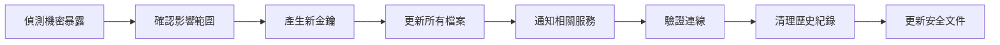
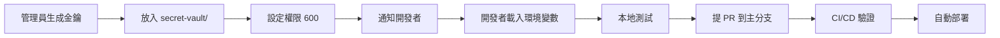

# 🔐 最佳實踐：機密管理與安全開發指南

> **版本**: 2026-11-02 v1.0  
> **適用範圍**: Omniesggo 專案  
> **遵循**: AGPL-3.0 License  
> **核心原則**: 絕不將機密值寫入程式碼、版本庫或對話中

---

## 1. 密鑰管理原則

### 1.1 機密資料分類

| 類別 | 範例 | 存放位置 | 權限 |
|------|------|----------|------|
| 開發環境 | `.env.local` | 本機開發 | `600` |
| 生產環境 | `secret-vault/ENV20230818.env` | 伺服器密鑰庫 | `600` |
| 環境變數 | `process.env` | 作業系統 | 依系統設定 |
| 外部服務 | API keys | 第三方憑證管理 | 依服務設定 |

### 1.2 嚴禁事項

```bash
# ❌ 絕對禁止
echo "API_KEY=real_value" >> .env
echo "SECRET=value" > code.js
echo "PASSWORD=123456" >> README.md
git add .env.local
git push origin main  # 現代密鑰已寫入歷史紀錄

# ✅ 必須
source .env.local
export $(grep -v '^#' .env.local | xargs)
```

### 1.3 密鑰輪替流程



**輪替週期**:
- 高風險金鑰（API Keys）：90 天
- 中危金鑰（資料庫連線）：180 天
- 低風險金鑰（助手帳號）：365 天

---

## 2. 環境變數配置

### 2.1 檔案結構

```
Omniesggo/
├── .env.example              # 模板（無真實值）
├── .env.local                # 本機開發（已 .gitignore）
├── .env.production.example   # 正式環境範例（無真實值）
├── .env.unified.example      # 統一環境範例（無真實值）
└── secret-vault/
    └── ENV20230818.env       # 機密聖櫃（已 gitignore）
```

### 2.2 範例：.env.example（已清除真實值）

```env
# ============================================
# AI / LLM 提供者
# 開發階段：使用免費/低成本模型
# ============================================
MISTRAL_API_KEY=***
MISTRAL_ADMIN_KEY=***
MISTRAL_WORKFLOW_KEY=***
GROQ_API_KEY=***

# ============================================
# 資料庫
# ============================================
SUPABASE_URL=https://your-project.supabase.co
SUPABASE_ANON_KEY=***
SUPABASE_SERVICE_ROLE_KEY=***

# ============================================
# 機密存取 (Junaikey × OmniMasterKey)
# 注意：不含真實值，請自行填入
# ============================================
NCBDB_API_TOKEN=***
NCBDB_PROJECT_ID=***
OMNIMASTER_KEY=***

# ============================================
# 雲端與部署
# ============================================
CLOUDFLARE_API_TOKEN=***
VPS_HOST=your-vps-host
VPS_USER=your-vps-user
VPS_KEY_PATH=~/.ssh/id_ed25519

# ============================================
# 其他設備
# ============================================
TESSDATA_PREFIX=C:\Program Files\Tesseract-OCR\tessdata
TESSERACT_CMD=C:\Program Files\Tesseract-OCR\tesseract.exe
```

### 2.3 環境變數載入順序

```bash
# 1. 系統環境變數
# 2. .env.local（本機開發）
# 3. secret-vault/ENV20230818.env（生產環境）
# 4. 作業系統環境變數（覆蓋上述）
```

---

## 3. 檔案安全

### 3.1 權限設定

```bash
# 機密檔案：600（僅所有者可讀寫）
chmod 600 secret-vault/ENV20230818.env
chmod 600 .env.local
chmod 600 .env.production

# 目錄：700（僅所有者可存取）
chmod 700 secret-vault/
chmod 700 .agents/rules/

# 確認權限
ls -la secret-vault/
```

### 3.2 .gitignore 設定

```gitignore
# 機密檔案
.env.local
.env.production.local
.env.omni.local
.env.unified.local
.env.production.local

# 機密聖櫃
secret-vault/

# 開發產物
*.log
*.tmp
__pycache__/
*.pyc

# 系統檔案
.DS_Store
Thumbs.db
```

### 3.3 權限修復腳本

```bash
#!/bin/bash
# scripts/fix-permissions.sh
set -euo pipefail

# 機密檔案權限
find secret-vault -type f -name "*.env" -exec chmod 600 {} \;
find . -name ".env*" -not -name ".env.example" -not -name ".env.unified.example" -not -name ".env.production.example" -exec chmod 600 {} \;

# 機密目錄權限
chmod 700 secret-vault/
chmod 700 .agents/rules/

echo "✅ 檔案權限已修復"
```

---

## 4. 版本控制安全

### 4.1 禁止提交的檔案清單

```bash
# .gitignore
# 機密檔案
.env.local
.env.production.local
.env.omni.local
.env.unified.local

# 私人金鑰
*.pem
*.key
*.p12
*.pfx

# 機密聖櫃
secret-vault/
```

### 4.2 提交前檢查

```bash
# 1. 檢查是否有真實機密值
grep -r "your_actual_\|sk-ant-\|gsk_\|mstrl_" . --include="*.env*" --include="*.sh" --include="*.js" --include="*.ts" 2>/dev/null

# 2. 檢查 git 歷史是否有機密值（需從已有提交中移除）
git log --all -p | grep -i "api_key\|password\|secret\|token" | head -20

# 3. 提交前檢查
git diff --cached | grep -i "api_key\|password\|secret\|token"
```

### 4.3 移除已提交的機密值

```bash
# 安裝 BFG Repo-Cleaner
java -jar bfg-*.jar --delete-files *.env.local

# 或使用 git filter-repo
git filter-repo --path *.env.local --invert-paths

# 強制推送（所有開發者需要重新 clone）
git push --force-with-lease
```

---

## 5. CI/CD 安全

### 5.1 GitHub Actions 安全

```yaml
# .github/workflows/ci-check.yml
name: Security Check

on:
  pull_request:
    branches: [main]
  push:
    branches: [main]

permissions:
  contents: read
  security-events: write

jobs:
  security-audit:
    runs-on: ubuntu-latest
    steps:
      - uses: actions/checkout@v4

      - name: 安裝依賴
        run: pnpm install --frozen-lockfile

      - name: 安全掃描
        run: |
          pnpm audit --production
          # 進一步安全掃描

      - name: 檢查敏感值
        run: |
          if grep -r "your_actual_" . --include="*.env*" ; then
            echo "❌ 發現真實機密值"
            exit 1
          fi
```

### 5.2 Secrets 管理

```yaml
# 設定方法
# Repository Settings → Secrets and variables → Actions

# 推薦的 Secrets 命名
# - NPM_TOKEN
# - GH_TOKEN
# - VAPT_KEY
# - SUPABASE_ANON_KEY
# - OMNIMASTER_KEY
```

---

## 6. 密鑰輪替最佳實踐

### 6.1 輪替檢測腳本

```bash
#!/bin/bash
# scripts/check-secret-exposure.sh
set -euo pipefail

# 掃描所有檔案
grep -r "your_actual_\|sk-ant-\|gsk_\|mstrl_" \
  --include="*.env*" \
  --include="*.sh" \
  --include="*.js" \
  --include="*.ts" \
  --include="*.py" \
  --include="*.md" \
  . 2>/dev/null | grep -v "^\s*#" | grep -v "^\s*$" | grep -v "^Binary file"

if [ $? -eq 0 ]; then
  echo "❌ 發現真實機密值！"
  exit 1
else
  echo "✅ 未發現真實機密值"
fi
```

### 6.2 自動化輪替

```bash
#!/bin/bash
# scripts/rotate-secrets.sh
set -euo pipefail

echo "🔄 開始機密輪替..."

# 產生新金鑰
new_ncbdb=$(openssl rand -base64 48)
new_omni=$(openssl rand -base64 48)
new_mistral=$(openssl rand -base64 48)
new_conduit=$(openssl rand -base64 32)
new_groq=$(openssl rand -base64 40)

# 更新檔案
cat > secret-vault/ENV20230818.env << EOF
NCBDB_API_TOKEN=$new_ncbdb
OMNIMASTER_KEY=$new_omni
MISTRAL_API_KEY=$new_mistral
CONDUIT_PASSWORD=$new_conduit
GROQ_API_KEY=$new_groq
EOF

chmod 600 secret-vault/ENV20230818.env

echo "✅ 機密輪替完成"
echo "⚠️  請立即通知所有相關服務更新金鑰"
```

---

## 7. 開發流程安全

### 7.1 提交規範

```bash
# ✅ 正確做法
git add .env.example
git commit -m "docs: 更新環境變數範例"

git add .env.local
git commit -m "chore: 更新本機配置"
# 但這不應提交到遠端

# ❌ 錯誤做法
git add .env.local
git commit -m "fix: 修復 bug"  # 含真實金鑰
git push origin main
```

### 7.2 分支規範

```bash
# 功能分支
git checkout -b feature/branch-name

# 提交格式
git commit -m "feat: 新功能描述"
git commit -m "fix: 修復 bug 描述"
git commit -m "docs: 文件更新"

# 合並主分支（squash）
git checkout main
git merge --squash feature/branch-name
git commit -m "docs: 更新內容"
```

---

## 8. 安全檢查清單

### 8.1 上傳前檢查

```bash
# 1. 檢查 .env 檔案
git status --porcelain | grep -E "\.env" || echo "✅ 沒問題"

# 2. 檢查機密值
grep -r "your_actual_" . --include="*.env*" 2>/dev/null && echo "❌ 有真實值" || echo "✅ 安全"

# 3. 檢查權限
ls -la secret-vault/*.env

# 4. 檢查 git 歷史
git log --all -p | grep -i "api_key\|password\|secret" | head -5
```

### 8.2 每日安全掃描

```bash
#!/bin/bash
# scripts/daily-security-scan.sh
set -euo pipefail

echo "📅 每日安全掃描"
echo "=============="

# 掃描真實機密值
echo "--- 掃描真實機密值 ---"
grep -r "your_actual_\|sk-ant-\|gsk_\|mstrl_" . \
  --include="*.env*" \
  --include="*.sh" \
  --include="*.js" \
  --include="*.ts" \
  --include="*.py" \
  --include="*.md" \
  2>/dev/null | grep -v "^\s*#" | grep -v "^\s*$"

# 掃描 README 中的真實值
grep -r "http://localhost:3000\|http://localhost:8080" . --include="*.md" 2>/dev/null

# 檢查秘密文件權限
ls -la secret-vault/*.env 2>/dev/null | awk '{print $1}' | grep -v "^-rw-------" && echo "❌ 權限異常" || echo "✅ 權限正常"

# 掃描 git 歷史
echo "--- 檢查 git 歷史 ---"
git log --all -p | grep -i "api_key\|password\|secret" | head -5

echo "✅ 掃描完成"
```

---

## 9. 團隊協同安全

### 9.1 密鑰分發流程



### 9.2 安全會議流程

```bash
# 1. 檢出最新分支
git checkout feature/branch-name

# 2. 檢查變更
git diff main..HEAD

# 3. 檢查機密值
grep -r "your_actual_" . --include="*.env*" 2>/dev/null && echo "⚠️ 有機密值" || echo "✅ 安全"

# 4. 驗證權限
ls -la secret-vault/ 2>/dev/null

# 5. 提交 PR
gh pr create --title "feat: 變更描述" --body "變更摘要..."
```

---

## 10. 常見問題排查

### 10.1 沒有 pip？

```bash
# Python venv 沒有 pip
python -m ensurepip --upgrade
```

### 10.2 權限被拒絕？

```bash
# 文件權限
chmod 600 secret-vault/ENV20230818.env

# 目錄權限
chmod 700 secret-vault/
```

### 10.3 找不到 .env 檔案？

```bash
# 確保在正確的目錄下
cd /c/Users/Administrator/Documents/Project/Omniesggo

# 或使用絕對路徑
source /c/Users/Administrator/Documents/Project/Omniesggo/.env.local
```

### 10.4 權限被拒絕（Windows）？

```powershell
# 取得完整控制權
icacls secret-vault\ENV20230818.env /grant "Administrator:(F)" /inheritance:r

# 檢查權限
icacls secret-vault\ENV20230818.env
```

---

## 11. 快速參考卡

### 每次提交前檢查清單

```
☑ 檢查 .env* 檔案是否已修改
☑ 檢查機密值未寫入版本庫
☑ 確認文件權限為 600
☑ 執行安全掃描腳本
☑ 提交 PR 並標記相關標籤
```

### 檢測腳本

```bash
#!/bin/bash
# 每天運行一次
echo "🔍 安全掃描開始..."
grep -r "your_actual_\|sk-ant-\|gsk_" . \
  --include="*.env*" \
  --include="*.sh" \
  --include="*.js" \
  --include="*.ts" \
  --include="*.py" \
  --include="*.md" \
  2>/dev/null
echo "🔍 掃描結束"
```

### 快速修復腳本

```bash
#!/bin/bash
# 修復機密檔案權限
chmod 600 secret-vault/ENV20230818.env
chmod 600 .env.local .env.production .env.unified .env.omni

# 重置權限
chmod 700 secret-vault/ .agents/rules/
```

---

## 12. 聯絡與報告

如發現機密字串中洩漏，請立即：
1. 停止使用受影響的金鑰
2. 產生新金鑰
3. 更新所有配置
4. 通知可信任的開發者
5. 記錄在 .security-lesson-20261102.md

---

**最終提醒**:  
🔒 任何 API 金鑰、密碼、機密資料均不得寫入程式碼或版本庫。  
📁 本機開發使用 `.env.local`。  
🏭 生產環境使用 `secret-vault/`。  
🔑 所有機密存取透過 `omni_get_secret()` 統一管理。  
🔍 輸出皆為 `***MASKED***`。  
📝 定期輪替敏感金鑰。
