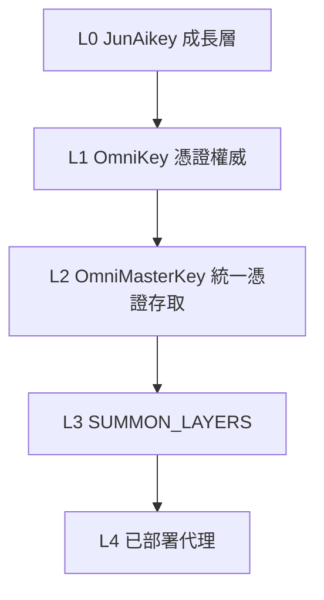
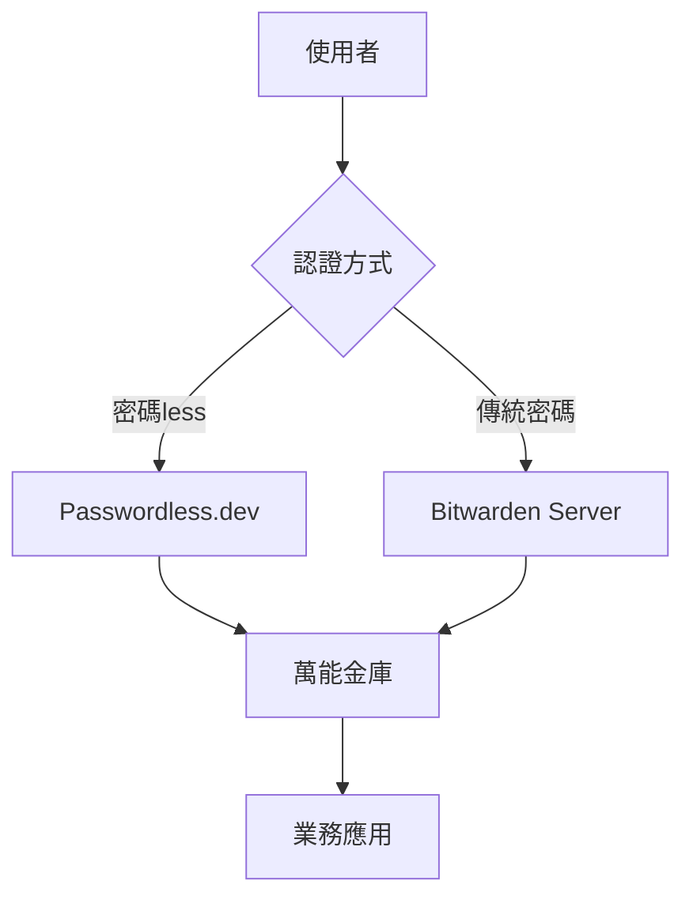
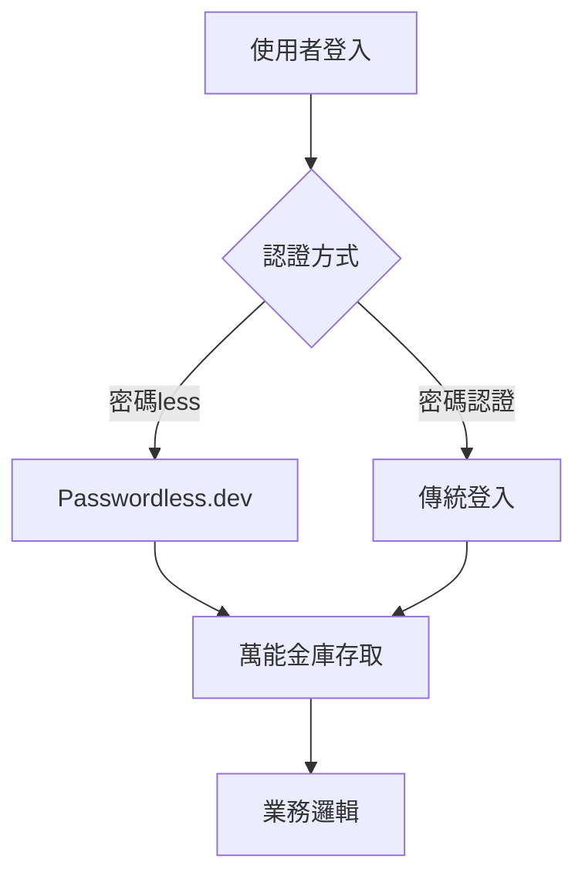

# 🌐 萬能金庫系統（OmniBitwarden）

> 萬能金庫系統（OmniBitwarden）是一套融合 Bitwarden 的通用憑證存取與安全金鑰管理系統，專為 Omniesggo 設計。
> 提供統一的憑證存取介面，支援多種金鑰類型、環境隔離、安全輪替與驗證。

---

## 📋 前置條件

1. 確認要處理的密碼是否已存在於 `secret-vault/` 中
2. 確認是否需要新增新的 API key 或更新現有金鑰
3. 確認操作不會寫入版本控制（使用 .gitignore 忽略的檔案）

---

## 🔄 流程

### 步驟 1：確認密碼屬性
- 判斷密碼類型：API Key、DB 密碼、OAuth Token、SSH Key
- 判斷存取範圍：開發環境、測試環境、生產環境
- 判斷存取方式：統一存取介面、環境變數、機密聖櫃

### 步驟 2：選擇存放位置
| 類型 | 存放位置 | 是否版本控制 |
|------|----------|------------|
| 本機開發 | `.env.local` | ✅ 已忽略 |
| 生產環境 | `secret-vault/ENV20230818.env` | ❌ 本機 Only |
| 萬能金庫 | `omni-bitwarden/` (Bitwarden 集成) | ❌ 本機 Only |
| 臨時憑證 | OneTimeSecret（人對人分享） | ❌ 臨時鏈接 |

### 步驟 3：檔案權限設定
```bash
# 機密聖櫃檔案權限
chmod 600 secret-vault/ENV20230818.env

# 機密目錄權限
chmod 700 secret-vault/

# 萬能金庫目錄權限
chmod 700 omni-bitwarden/
```

### 步驟 4：統一存取介面
```python
# Python 統一存取
from omni_master_key import omni_get_secret, omni_add_secret

# 查詢金鑰
result = omni_get_secret("GITHUB_TOKEN")
if result["found"]:
    os.environ["GITHUB_TOKEN"] = result["value"]  # 僅在進程內非遮蔽
    print(f"Source: {result['source']}")  # 輸出來源，不輸出值

# 增加金鑰到萬能金庫
result = omni_add_secret(
    key="GITHUB_TOKEN",
    value="***MASKED***",
    vault_type="bitwarden",
    scope="production",
    auto_rotate=True
)
```

---

## 🌐 萬能金庫架構

### 1. 三層憑證架構



### 2. 存放位置選擇
| 類型 | 存放位置 | 是否版本控制 |
|------|----------|------------|
| 本機開發 | `.env.local` | ✅ 已忽略 |
| 生產環境 | `secret-vault/ENV20230818.env` | ❌ 本機 Only |
| 萬能金庫 | `omni-bitwarden/` (Bitwarden 集成) | ❌ 本機 Only |
| 臨時憑證 | OneTimeSecret（人對人分享） | ❌ 臨時鏈接 |

### 3. 安全原則
- ❌ 絕不硬編碼：任何 API 金鑰、密碼、機密資料均不得寫入程式碼
- ❌ 不輸出真實值：對話過程中任何機密值都必須遮罩（`***MASKED***`）
- ✅ 環境變數：本地開發使用 `.env.local`（已 `.gitignore` 忽略）
- ✅ 機密聖櫃：生產環境使用 `secret-vault/` 目錄
- ✅ 統一存取：透過 `omni_get_secret()` 函數存取
- ✅ MASKED 輸出：所有憑證查詢結果均以 `***MASKED***` 顯示
- ✅ 權限控制：`secret-vault/` 目錄權限 600，僅所有者可讀寫
- ✅ 出口清理：程式結束時清理環境變數中的機密值

---

## 🛠️ 安裝指南

### 1. 安裝 OpenBountyman 或類似工具
```bash
# 根據你的密碼管理系統安裝 CLI
# 例如：1Password CLI, Bitwarden CLI, Vault CLI 等

# 檢查安裝
bitwarden --version
```

### 2. 初始化萬能金庫
```bash
# 創建萬能金庫目錄
mkdir -p omni-bitwarden

# 複製配置模板
cp omni-bitwarden.example/config.yaml omni-bitwarden/config.yaml

# 配置金鑰
# 修改 config.yaml 填入你的金鑰
```

### 3. 設定環境變數
```bash
# 在 .env.local 中添加
OMNIBITWARDEN_ENABLED=true
OMNIBITWARDEN_CONFIG=omni-bitwarden/config.yaml
```

---

## 🔐 安全守則

1. **絕不硬編碼**：任何 API 金鑰、密碼、機密資料均不得寫入程式碼
2. **環境變數**：本地開發使用 `.env.local`（已 `.gitignore` 忽略）
3. **機密聖櫃**：生產環境使用 `secret-vault/` 目錄
4. **統一存取**：透過 `omni_get_secret()` 函數存取
5. **MASKED 輸出**：所有憑證查詢結果均以 `***MASKED***` 顯示
6. **權限控制**：`secret-vault/` 目錄權限 600，僅所有者可讀寫
7. **出口清理**：程式結束時清理環境變數中的機密值
8. **禁止顯示真實值**：對話過程中任何機密值都必須遮罩（`***MASKED***`）

---

## 🏗️ 系統整合

### 1. 名稱解析系統
```typescript
// src/agents/omni-key.ts
// 統一憑證存取介面

export function omni_get_secret(key: string, scope?: string): SecretResult {
  // 檢查萬能金庫
  const vaultValue = vaultManager.get(key, scope);
  if (vaultValue) {
    return { found: true, value: vaultValue, source: "omni-bitwarden" };
  }
  // 檢查環境變數
  const envValue = process.env[key];
  if (envValue) {
    return { found: true, value: maskValue(envValue), source: "environment" };
  }
  // 檢查秘密聖櫃
  const vaultValue = readSecretVault(key);
  if (vaultValue) {
    return { found: true, value: maskValue(vaultValue), source: "secret-vault" };
  }
  return { found: false };
}
```

### 2. 配置檔案
```yaml
# omni-bitwarden/config.yaml
vault:
  enabled: true
  type: bitwarden
  endpoint: https://vault.esggo.co
  token: ${OMNIBITWARDEN_TOKEN}

scopes:
  - name: development
    path: .env.local
  - name: production
    path: secret-vault/ENV20230818.env

secrets:
  - name: NCBDB_API_TOKEN
    scope: production
    auto_rotate: true
  - name: MISTRAL_API_KEY
    scope: development
    auto_rotate: false
  - name: GROQ_API_KEY
    scope: development
    auto_rotate: false
```

---

## ✅ 驗證清單

- [ ] 密碼未出現在程式碼中
- [ ] 密碼在 `.env` 文件中，且已 `.gitignore` 忽略
- [ ] 終端機歷史記錄中不包含密碼
- [ ] 密碼在顯示時已遮罩
- [ ] 密碼在程式結束時清理
- [ ] 檔案權限設定正確（600 或 700）
- [ ] 統一存取介面已使用

---

## 📌 引用文件

- `omni_master_key.py` - 統一憑證存取函數
- `verify_omni_master_key.py` - 機密驗證腳本
- `global-rule.md` - 憲章安全原則
- `OMNISKILL_BOOK.md` - 技能書索引
- `references/ENV20230818-template.md` - ENV20230818.pdf 環境變數模板結構

---

## 📖 參考資源

- [Bitwarden CLI Documentation](https://bitwarden.com/help/cli/)
- [OmniMasterKey 系統設計](./omni-master-key/SKILL.md)
- [Junaikey 成長層](./omni-master-key/SKILL.md)
- [安全原則與密碼學](./OMNISKILL_BOOK.md#37-安全與密碼學原則)

## 🌐 引用資源（Bitwarden 相關專案）

| 專案名稱 | 倉庫地址 | 說明 |
|----------|----------|------|
| **Bitwarden Server** | [DingJun1028/server](https://github.com/DingJun1028/server) | Bitwarden 後端基礎設施，包含 API、資料庫、Docker 配置等 |
| **Bitwarden Clients** | [DingJun1028/clients](https://github.com/DingJun1028/clients) | Bitwarden 客戶端應用（Web、桌面、瀏覽器擴展、CLI） |
| **Passwordless Node.js** | [DingJun1028/passwordless-nodejs](https://github.com/DingJun1028/passwordless-nodejs) | Bitwarden Passwordless.dev Node.js SDK，支援無密碼認證 |

### 1. Bitwarden Server 參考

Bitwarden 伺服器後端（C#、TypeScript、SQL Server）提供：

- **API 伺服器**：REST API 與 WebSocket 連接
- **資料庫**：SQL Server 架構與 migrations
- **Docker**：容器化部署配置
- **認證系統**：JWT、Refresh Token、OAuth 2.0

### 2. Bitwarden Clients 參考

Bitwarden 客戶端應用包含：

- **Web 客戶端**：瀏覽器應用（TypeScript、React）
- **桌面客戶端**：Electron 應用（TypeScript、Rust）
- **瀏覽器擴展**：Chrome、Firefox、Edge 擴展
- **CLI 工具**：命令列密碼管理工具

### 3. Passwordless Node.js 參考

無密碼認證 SDK：

```bash
npm i @passwordlessdev/passwordless-nodejs
```

```typescript
import { PasswordlessClient } from '@passwordlessdev/passwordless-nodejs';

const client = new PasswordlessClient(process.env.PASSWORDLESS_SECRET!, {
  baseUrl: 'https://v4.passwordless.dev'
});

// 註冊
const registerToken = await client.createRegisterToken({
  userId: 'user-id',
  username: 'user@example.com',
  aliases: ['device-name']
});

// 登入驗證
const verifiedUser = await client.verifyToken(token);
```

### 4. 整合方式



## 🔐 密碼less 認證整合（參考）

### 1. Passwordless.dev Node.js SDK

[passwordless-nodejs](https://github.com/DingJun1028/passwordless-nodejs) 是 Bitwarden 官方的 Passwordless.dev Node.js SDK，提供無密碼認證功能（Magic Link / 密碼less 登入）。

#### 套件安裝

```bash
npm i @passwordlessdev/passwordless-nodejs
```

#### 基本用法

```typescript
import { PasswordlessClient } from '@passwordlessdev/passwordless-nodejs';

// 創建 PasswordlessClient 實例
const options: PasswordlessOptions = {
  baseUrl: 'https://v4.passwordless.dev'
};
const passwordlessClient = new PasswordlessClient(process.env.PASSWORDLESS_SECRET!, options);

// 註冊
const registerOptions = new RegisterOptions();
registerOptions.userId = userId;
registerOptions.username = username;
registerOptions.aliases = [deviceName];
registerOptions.discoverable = true;

const token = await passwordlessClient.createRegisterToken(registerOptions);

// 登入驗證
const verifiedUser = await passwordlessClient.verifyToken(token);
if (verifiedUser.success) {
  // 使用 JWT 建立用戶 session
}
```

#### 環境變數配置

| 變數名稱 | 範例值 | 說明 | 必填 |
|----------|--------|------|------|
| `PASSWORDLESS_API` | `https://v4.passwordless.dev` | Passwordless.dev 後端基礎網址 | 否 |
| `PASSWORDLESS_SECRET` | `demo:secret:f831e39c29e64b77aba547478a4b3ec6` | 從 AdminConsole 取得的 Secret | 是 |

### 2. 密碼less 與傳統密碼管理結合



### 3. 安全原則

- **不硬編碼**：`PASSWORDLESS_SECRET` 必須存放在環境變數或密碼管理系統
- **Masked 輸出**：任何取得的值都必須遮蔽輸出
- **最小權限**：密碼less 認證僅用於驗證身分，不存取敏感數據
- **輪替機制**：定期輪替 `PASSWORDLESS_SECRET`

---

## ⚠️ 注意事項

1. **金鑰輪替**：每 90 天輪替一次高風險金鑰
2. **密碼管理**：勿將真實密碼寫入程式碼或版本庫
3. **最小權限**：僅授予必要的服務存取權限
4. **密碼輪替**：定期輪替敏感密碼
5. **安全教訓**：參考 `.security-lesson-20261102.md` 學習經驗
